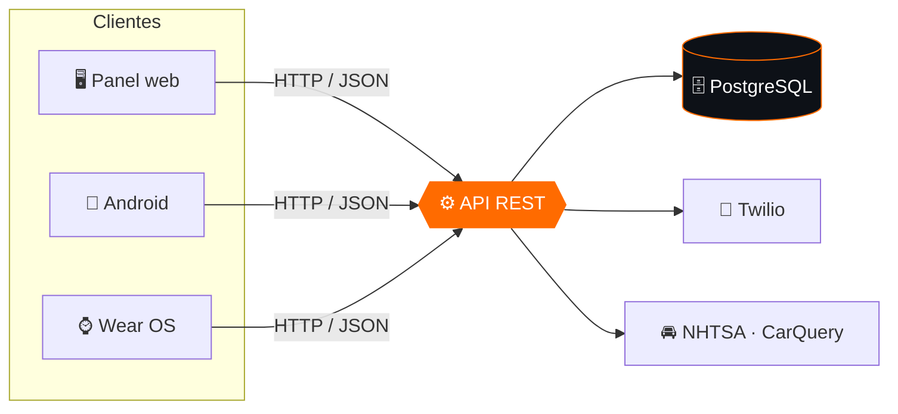

<!-- ═══════════════════════════  HEADER  ═══════════════════════════ -->
<p align="center">
  
</p>

<p align="center">
  <a href="https://github.com/klo55jhn-prog">
    
  </a>
</p>

<p align="center">
  <a href="https://www.linkedin.com/in/carlos-john-blanco-aguila-98b40036b/"></a>
  <a href="mailto:klo55jhn@gmail.com"></a>
  
  
</p>

<br/>

<!-- ═══════════════════════════  ABOUT  ═══════════════════════════ -->
<h2>🏁 &nbsp;Sobre mí</h2>

<table>
<tr>
<td width="58%" valign="top">

```kotlin
data class Developer(
    val name: String      = "Carlos John Blanco",
    val role: String      = "Multiplatform App Developer",
    val studies: String   = "2º DAM @ U-tad (2025 – 2027)",
    val location: String  = "Madrid, España 🇪🇸",
    val building: String  = "MotorHub 🚗 — mi TFG",
    val focus: List<String> = listOf(
        "Jetpack Compose", "APIs REST", "IA Generativa"
    ),
    val learning: List<String> = listOf("Docker Compose", "AWS"),
    val speaks: List<String> = listOf(
        "Español (nativo)", "Inglés (B2)", "Francés (medio)"
    ),
    val openTo: String = "Prácticas · Colaboraciones · Proyectos"
)
```

</td>
<td width="42%" valign="top">

Me gusta **construir producto de punta a punta**: desde la API y la base de datos hasta la app que tienes en la mano (o en la muñeca ⌚).

Vengo del **deporte de equipo**, así que la constancia, la disciplina y jugar para el equipo no son frases de CV: es como trabajo.

> 💡 *"Código limpio, mente abierta y ganas de seguir creciendo."*

</td>
</tr>
</table>

<br/>

<!-- ═══════════════════════════  STACK  ═══════════════════════════ -->
<h2>🔧 &nbsp;Caja de herramientas</h2>

<p align="center">
  <br/>
  
</p>

<table align="center">
<tr>
<th>📱 Móvil & Desktop</th>
<th>🔌 Backend & Datos</th>
<th>☁️ DevOps & Cloud</th>
</tr>
<tr>
<td valign="top">

- Kotlin · KMP
- Jetpack Compose
- Wear OS (Compose for Wear)
- Coroutines
- Java · Swing

</td>
<td valign="top">

- APIs REST
- JDBC
- MySQL · PostgreSQL
- MongoDB · Oracle SQL
- Python

</td>
<td valign="top">

- Docker · Docker Compose
- AWS (EC2, VPC, CloudFront)
- Git · GitHub
- DBeaver · HeidiSQL
- VirtualBox

</td>
</tr>
</table>

<br/>

<!-- ═══════════════════════════  MOTORHUB  ═══════════════════════════ -->
<h2>🚗 &nbsp;En el box ahora mismo: MotorHub</h2>

<p align="center">
  
  
  
  
</p>

<p align="center"><b>Gestión integral de taller y concesionario, sincronizada en tiempo real entre web, móvil y smartwatch.</b></p>

<table>
<tr>
<td width="50%" valign="top">

#### 🖥️ Panel web
Roles **Gerente · Mecánico · Cliente**, inventario de vehículos y piezas y un **tablero Kanban** de citas con asignación de mecánicos.

#### 📱 App Android
**Jetpack Compose.** Perfil cliente (catálogo, citas, estado en vivo) y perfil mecánico (tareas, **escáner QR** de piezas).

</td>
<td width="50%" valign="top">

#### ⌚ Wear OS
Cronómetro de reparación (iniciar / pausar) y actualización de estado al servidor **desde la muñeca**.

#### 🔔 Backend + notificaciones
API REST propia sobre PostgreSQL, integración con **NHTSA**, **CarQuery** y **Twilio** para avisar al cliente al terminar.

</td>
</tr>
</table>



<details>
<summary><b>🗓️ Hoja de ruta (3 meses)</b></summary>
<br/>

| Vuelta | Foco | Meta |
|:-:|:--|:--|
| 🟠 **1** | Planificación, wireframes en Figma, backend base, APIs externas, panel web (inventario + Kanban) | Primera revisión de backend y web |
| 🟠 **2** | App Android (cliente y mecánico), seguimiento en tiempo real, app Wear OS | Primera tutoría de seguimiento |
| 🏁 **3** | Notificaciones, testing (JUnit + pruebas de API), pulido de UI, memoria y vídeo | Entrega final y defensa (junio) |

</details>

<br/>

<!-- ═══════════════════════════  PROJECTS  ═══════════════════════════ -->
<h2>🏆 &nbsp;Garaje de proyectos</h2>

<table>
<tr>
<td width="50%" valign="top">

### 🏋️ KRAFT
<sub>Proyecto integrador · 1º DAM</sub>

App de escritorio que convierte el entrenamiento en un **RPG**: niveles, misiones diarias y semanales, clanes, rankings y tienda de cosméticos. Arquitectura **MVC** con 19 vistas, **2FA por OTP** vía email y panel de administración.


</td>
<td width="50%" valign="top">

### 📦 [StockPyme](https://github.com/klo55jhn-prog/stockpyme)
<sub>Práctica para el TFG · 2º DAM</sub>

Gestión de inventario pensada para **pequeños comercios**, con app Android y backend en Spring Boot. Banco de pruebas de la arquitectura que llevo a MotorHub.


</td>
</tr>
<tr>
<td width="50%" valign="top">

### 📻 Radio U-tad Platform
<sub>Proyecto multidisciplinar · DAM / DAW / ASIR</sub>

Plataforma web para una emisora de radio: diseño de la **API REST**, modelado de la base de datos e integración con el frontend, trabajando con perfiles de DAW y ASIR.


</td>
<td width="50%" valign="top">

### 📲 [Proyecto Integrador 2º DAM](https://github.com/klo55jhn-prog/ProyectoIntegrados2Dam)
<sub>Proyecto en grupo · 2º DAM</sub>

App móvil en **Kotlin** desarrollada en equipo como proyecto integrador del segundo curso.


</td>
</tr>
</table>

<br/>

<!-- ═══════════════════════════  TIMELINE  ═══════════════════════════ -->
<h2>🛣️ &nbsp;Trayectoria</h2>

| | Cuándo | Qué | Dónde |
|:-:|:-:|:--|:--|
| 💼 | **May – Jun 2026** | **Application Designer & Developer:** backend y API REST (endpoints, controladores, validaciones, BD) y frontend integrado para una plataforma de radio | Reddo Tanuki |
| 🤖 | **2026** | Especialización en **IA Generativa** | — |
| 🎓 | **2025 – 2027** | T.S. en **Desarrollo de Aplicaciones Multiplataforma** | U-tad · Las Rozas |
| 🔬 | **2023 – 2025** | Bachillerato de Ciencias y Tecnología | IES Mariana Pineda · Madrid |

<br/>

<!-- ═══════════════════════════  STATS  ═══════════════════════════ -->
<h2>📈 &nbsp;Telemetría</h2>
<p align="center">
  
</p>

<p align="center">
  
</p>

<p align="center">
  
</p>

<p align="center">
  
</p>

<br/>

<!-- ═══════════════════════════  SOFT SKILLS  ═══════════════════════════ -->
<h2>🤝 &nbsp;Fuera del código</h2>

<p align="center">
  
  
  
  
  
</p>

<br/>

<!-- ═══════════════════════════  CONTACT  ═══════════════════════════ -->
<h2 align="center">📡 &nbsp;¿Hablamos?</h2>

<p align="center">
  ¿Prácticas, un proyecto o una charla sobre tecnología? Mi bandeja está abierta.
</p>

<p align="center">
  <a href="https://www.linkedin.com/in/carlos-john-blanco-aguila-98b40036b/"></a>
  <a href="mailto:klo55jhn@gmail.com"></a>
</p>

<p align="center">
  
</p>
