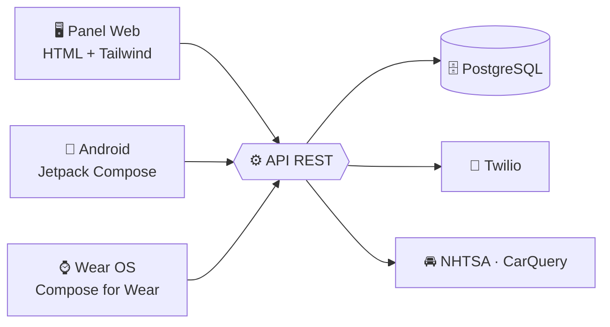

  

 

## 👋 Sobre mí

Desarrollador de aplicaciones multiplataforma con mentalidad **activa, constante y orientada a resolver problemas técnicos de forma práctica**. Me muevo entre el **móvil con Jetpack Compose**, el **backend con APIs REST** y la **integración de IA Generativa**, y trabajo bien en equipos multidisciplinares gracias a mi background en deporte de equipo.

<table>
<tr>
<td width="50%" valign="top">

**🔭 Ahora mismo**
- 🚗 Desarrollando **MotorHub** (TFG)
- 🎓 2º **DAM** en U-tad
- 🤖 Aplicando **IA Generativa** a mis proyectos
- 🌱 Profundizando en **Docker Compose** y **AWS**

</td>
<td width="50%" valign="top">

**📌 Datos rápidos**
- 📍 Madrid, España (Moratalaz)
- 🗣️ Español (nativo) · Inglés (B2) · Francés (medio)
- 🏋️ Creador de **KRAFT**, app fitness con gamificación
- 🤝 Abierto a prácticas, colaboraciones y proyectos

</td>
</tr>
</table>

 

## 🛠️ Tech Stack

<table>
<tr>
<td width="50%" valign="top" align="center">

**📱 Móvil, Desktop y Lenguajes**  
 
Kotlin · KMP · Jetpack Compose · Coroutines · Java · Swing · Python

</td>
<td width="50%" valign="top" align="center">

**🌐 Web y APIs**  
 
JavaScript · HTML5 · CSS3 · Tailwind · Bootstrap · APIs REST

</td>
</tr>
<tr>
<td width="50%" valign="top" align="center">

**🗄️ Bases de datos**  
 

 
MySQL · PostgreSQL · MongoDB · Oracle · SQL

</td>
<td width="50%" valign="top" align="center">

**☁️ DevOps y control de versiones**  
 
Docker · Docker Compose · AWS (EC2, VPC, CloudFront) · Git · GitHub

</td>
</tr>
</table>

### 🧰 Herramientas que uso a diario

 

## 🚗 Proyecto estrella · MotorHub (TFG)

**Gestión integral de taller y concesionario con sincronización en tiempo real entre web, móvil y smartwatch.**

| | Componente | Qué hace |
|:-:|:--|:--|
| 🖥️ | **Panel Web** | Roles (Gerente, Mecánico, Cliente), inventario de vehículos y piezas, **tablero Kanban** de citas con asignación de mecánicos |
| 📱 | **App Android** | Jetpack Compose · Perfil **cliente** (catálogo, citas, estado en vivo) y perfil **mecánico** (tareas, escáner QR de piezas) |
| ⌚ | **Wear OS** | Cronómetro de reparación (iniciar/pausar) y actualización de estado al servidor desde la muñeca |
| 🔔 | **Notificaciones** | Aviso automático al cliente al terminar la reparación |
| 🔌 | **Backend** | API REST propia con PostgreSQL y consumo de APIs externas (**NHTSA**, **CarQuery**, **Twilio**) |

<b>🗓️ Ver hoja de ruta (3 meses)</b>

 

| Mes | Foco | Hito |
|:-:|:--|:--|
| **1** | Planificación, wireframes en Figma, backend base, APIs externas, panel web (inventario + Kanban) | 🎯 Primera revisión de backend y web |
| **2** | App Android (cliente y mecánico), seguimiento en tiempo real, app Wear OS | 🎯 Primera tutoría de seguimiento |
| **3** | Notificaciones, testing (JUnit y pruebas de API), pulido UI, memoria y vídeo | 🎯 Entrega en BlackBoard y defensa en junio |

<!-- ✏️ Cambia esta URL por la del repo de MotorHub cuando lo tengas -->

 

## 📂 Otros proyectos

| Proyecto | Descripción | Stack |
|:--|:--|:--|
| 🏋️ [**KRAFT**](https://github.com/klo55jhn-prog/KRAFT) | **Proyecto Integrador 1º DAM.** App de escritorio de fitness y gamificación: rutinas, progreso por puntos, minijuegos y persistencia relacional | `Java` `Swing` `JDBC` `SQL` `POO` |
| 📻 [**Radio U-tad Platform**](https://github.com/klo55jhn-prog/Radio-Utad) | **Proyecto multidisciplinar DAM/DAW/ASIR.** Plataforma web para radio: API REST, modelado de BD e integración con el cliente | `REST API` `SQL` `JavaScript` `HTML/CSS` `Git` |

 

## 💼 Experiencia

<table>
<tr>
<td width="140" align="center">
  🦊
</td>
<td>

### Application Designer & Developer · Reddo Tanuki
Plataforma web integral para una emisora de radio.

- ⚙️ **Backend:** arquitectura y API REST (endpoints, controladores, validaciones y conexión a BD)
- 🎨 **Frontend:** maquetación e integración de interfaces con los endpoints
- 🤝 **Equipo:** trabajo con especialistas de **DAW** y **ASIR**

</td>
</tr>
</table>

## 🎓 Formación

| Periodo | Titulación | Centro |
|:-:|:--|:--|
| **2025 – 2027** | 🖥️ T.S. en **Desarrollo de Aplicaciones Multiplataforma (DAM)** | U-tad · Las Rozas |
| **2026** | 🤖 Especialización en **IA Generativa** | — |
| **2023 – 2025** | 🔬 Bachillerato de Ciencias y Tecnología | IES Mariana Pineda · Madrid |

 

## 🤝 Soft skills

 

## 📊 GitHub

 

 

## 📫 Contacto

**¿Proyecto, prácticas o charla sobre tecnología? ¡Escríbeme!**

 

*"Código limpio, mente abierta y ganas de seguir creciendo."* ✨

